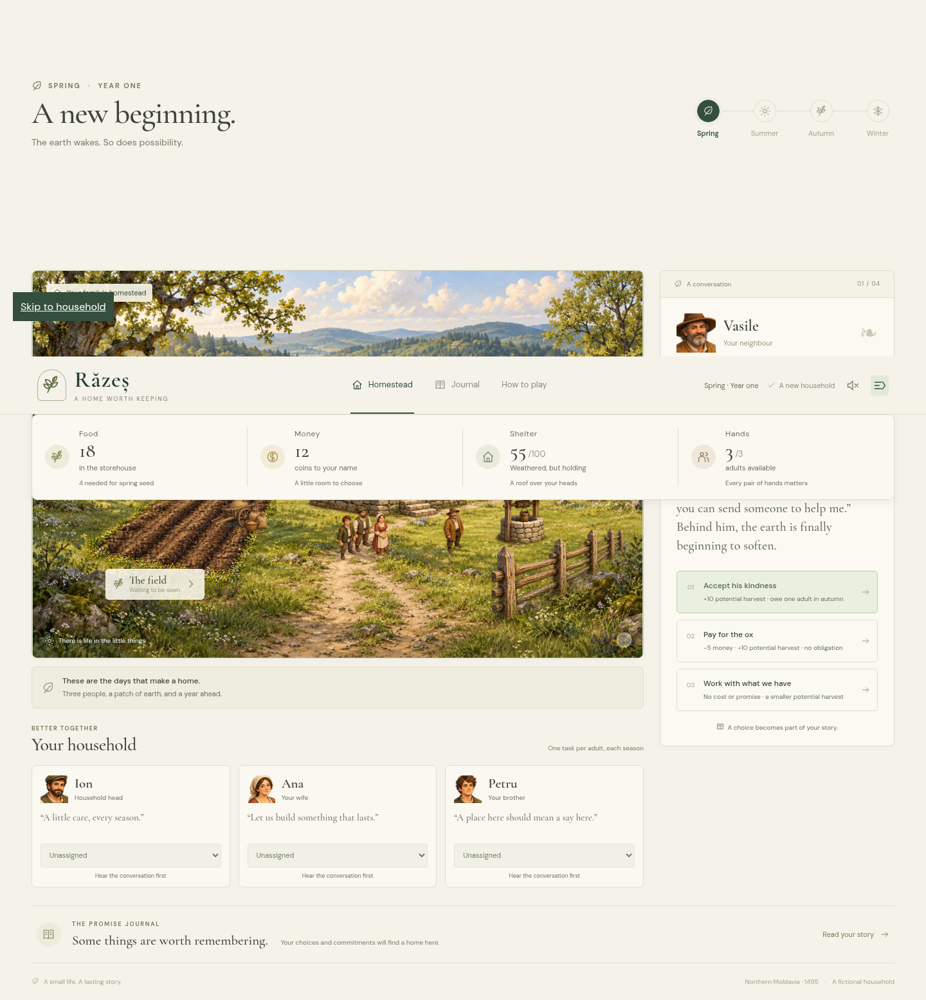

# Răzeș

**A home worth keeping.** A single-player browser game about three adults, four seasons, and the promises that hold a household together. Set in northern Moldavia in 1495; the household and village are fictional.



## Run locally

Requires Node.js 24 and npm 11. No backend, API keys, accounts, or runtime network requests are required.

```sh
npm ci
npm run dev
```

For the managed cloud workspace, use `npm ci --cache /tmp/razes-npm-cache`. The development server binds to `0.0.0.0`; the default port is 5173. To create a static production build:

```sh
npm run build
npm run preview
```

`dist/` contains the deployable files. Nothing has been deployed by this implementation.

## Play

1. Read the seasonal conversation and choose a response. Costs and obligations are explicit.
2. Assign one task to each adult, either through a task card or the selector beside their portrait. Assignments remain editable. Harvest needs two adults.
3. Review the forecast and confirm. Work resolves first, followed by an evening conversation, then consumption and weathering.
4. Continue through winter to see the household’s ending and three consequential choices.

Borrowing Vasile’s ox promises one adult in autumn. Honouring reserves Petru’s existing assignment exactly once; breaking the promise removes winter help. Paying costs 5 money and leaves your autumn labour free; declining keeps the cash but gives a smaller crop.

The promise journal records decisions and neighbourly work. Every accepted action saves locally, including draft assignments. Reload resumes the recorded phase. Corrupt or incompatible saves display an explanation and an explicit fresh-start action. Storage failures warn without discarding the live run. Saves do not sync across devices.

All essential controls work through labelled HTML buttons and selectors. Tab/Enter activate controls; Escape closes dialogs. The header has reduced-motion and sound controls. Sound starts only after choosing to enable it.

## Checks

```sh
npm test           # Rules, save validation, 400 varied complete years
npm run build     # Strict TypeScript check and production bundle
npm run test:e2e   # Browser paths, reload, keyboard, scenes and save recovery
```

Browser tests use the installed `/usr/bin/chromium` in the cloud image. On another machine, set `CHROMIUM_PATH` to a Chromium executable. If using a Playwright-managed browser, set it to the path returned by `chromium.executablePath()` after installing Chromium through Playwright. Browser testing needs no external web services.

Visual artifacts are written to `test-results/`. The seasonal test captures spring damage, planted/repaired spring, summer growth, ripe autumn, harvested/full autumn, and winter. Tests also sample the canvas to detect an empty scene.

## Project map

- `src/game/types.ts`: authoritative state and action/content types.
- `src/game/balance.ts`: all numerical tuning and task definitions.
- `src/game/content.ts`: twelve authored event definitions; eight encounters per run.
- `src/game/rules.ts`: deterministic immutable actions, affordability, previews and endings.
- `src/game/save.ts`: versioned snapshots, structural and progression validation, storage recovery.
- `src/scene/art.ts`: portrait windows into the shared painted character atlas.
- `src/scene/presentation.ts`: pure mapping from game state to visual states.
- `public/art/`: four painted landscapes and separate building, field, and character atlases.
- `src/scene/Homestead.ts`: Phaser scene, seasonal layers, hotspots and optional animation.
- `src/ui/`: accessible DOM rendering, icons and locally synthesized audio.
- `src/main.ts`: event wiring, focus handling and persistence.

Fonts are bundled from Fontsource (DM Sans and Cormorant Garamond); the app does not load Google Fonts or external artwork. The painted artwork was generated for this implementation with OpenAI image generation; icons are local SVGs. The original PNG assets total about 25 MB and are loaded locally on the first scene load. See `docs/art/2026-10-21-painterly-pass.md` for provenance and limitations. Dependency licenses remain with their respective packages.

## Scope and next validation

This is an implemented first playable MVP: a full functional year, illustrated seasonal scenes, ox chain, local saves, audio controls, and endings. The original plan and design decisions are in `docs/superpowers/`.

The illustration uses layered painterly assets with seasonal weather, breathing, work tools and motions, and chimney smoke. Reduced motion freezes optional canvas animation. The first historical reference pass anchors the fiction in northern Moldavia in 1495 and revises shared inheritance and boundary mediation. Dated references for the painted clothes, buildings and tools still need specialist review. See the [historical guide](docs/history/1495-reference-guide.md) for inspected sources, terminology, and the art handoff.

The proposed 20–30-minute pacing and the emotional/replayability acceptance criteria are **not yet validated**. Run the brief’s five-person playtest before treating the game as release-ready. Ask players what they remember before prompting them about relationships. The [ox balance audit](docs/audits/2026-10-22-ox-balance.md) compares all four routes across eight narrative profiles and documents the hire-price change from 6 to 5. Its [reproducible analyzer](docs/audits/ox-balance.mjs) uses the real rules. All four routes have distinct resource advantages under those profiles; this is not evidence of player enjoyment or equal difficulty. Tune values in `balance.ts` rather than adding unrelated systems. Mobile receives a usable fallback layout but desktop/laptop remains the target.

## Native macOS app

A SwiftUI + SpriteKit version lives in [`native/macos/`](native/macos/README.md), with an Ion-only settlement, a 48-week calendar, grain seeds and crop growth, solo farming, weekly health/energy/hunger simulation, work-earned skills and death/restart, a large layered isometric household, portrait commands, a pannable/zoomable map, eleven freely placed buildings with five levels, weekly wood/stone gathering, Galbeni currency, immediate material buying and Workshop plank crafting, Strength/Endurance progression, a readable construction catalogue with house/skill/prerequisite unlocks, shared expandable storage, seasonal construction/production/decay, instant upgrades/repairs, map and building rotation, pavement/fence painting, a building debug workshop and local saves. Open its `Package.swift` in Xcode or use its packaging script to build a locally runnable `.app`. The browser game remains independently runnable.

## Godot 3D desktop game

[`godot/`](godot/README.md) contains the standalone Godot 4.7.2 port targeting Mac, Windows and Linux. It follows the native Ion settlement rules, with real textured 3D buildings, shared physical scale, an orthographic camera, seasonal ground/roofs and local saves. Start with 16 × 16 land and buy adjoining 16 × 16 parcels for 20 Galbeni each, up to 48 × 48. A debug building workshop lets you inspect all buildings and levels.

Open `godot/project.godot` in Godot and press F5, or run `./godot/run.sh`. Run `./godot/test.sh` for the headless checks. Desktop export presets are included; binary exports need the matching Godot export templates. See [`godot/VALIDATION.md`](godot/VALIDATION.md) for completed checks and platform limits. This port uses separate saves and does not import native/browser progress.
